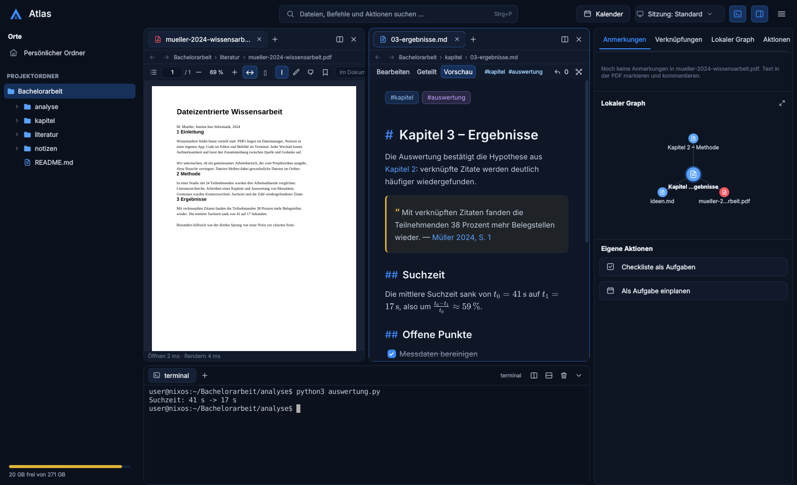
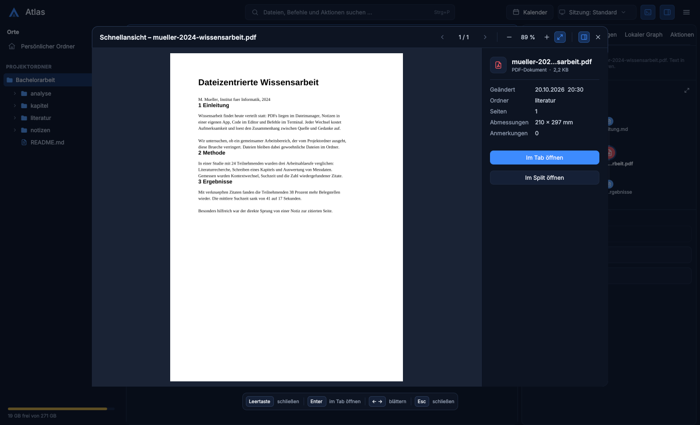

# Atlas Workspace

**Ein dateizentrierter Arbeitsplatz für Linux:** Projektordner, PDFs,
Markdown-Notizen, Code und Terminal in einem Fenster – für Studium,
Forschung und alle, die mit vielen Dateien in einem Ordner arbeiten.

*A file-centric desktop workspace for Linux (Qt 6, Wayland-first) that
combines a project folder, PDF annotation, linked Markdown notes, code
preview and a terminal. The user interface is German for now.*



Deine Dateien bleiben gewöhnliche Dateien in deinem Ordner. Atlas legt nur
einen versteckten Unterordner `.atlas/` an (Sessions, Anmerkungen, Index) und
verändert weder PDFs noch Notizen ungefragt.

## Funktionen

- **Projektordner** mit Verzeichnisbaum, Dateiansicht (Symbole oder Details),
  Orten wie in Dolphin, Papierkorb sowie Besitzer, Gruppe und Rechten.
- **Tabs und Splits** mit Ziehen und Ablegen. Jeder Projektordner ist eine
  **Session**: Tabs, Splits und Baum werden automatisch gespeichert, das
  Sessionmenü wechselt zwischen deinen Ordnern.
- **Schnellansicht** mit der Leertaste für PDFs, Bilder, Markdown und Code.
- **PDFs** markieren, kommentieren, mit Lesezeichen versehen und zitieren –
  die PDF selbst bleibt unverändert; Export als Kopie mit Anmerkungen,
  Dunkelmodus mit umgekehrten Farben.
- **Markdown** mit Live-Vorschau, Formeln (KaTeX), Diagrammen (Mermaid),
  Checklisten, Tags, Wiki-Links, Backlinks und lokalem Graph. Zitate springen
  direkt zur Stelle in der PDF.
- **Arbeitsleiste** (`Strg+P`) für Dateien, Aktionen, Tags, Zitate, Termine
  und Volltext; projektweite Suche mit ripgrep.
- **Terminal** im Fenster, **eigene Aktionen** und Skripte, kleine
  **Erweiterungen**.
- **Projektkalender** mit Fristen aus Notizen und optionaler
  Synchronisierung mit Nextcloud (CalDAV) oder Google-Kalender
  ([Einrichtung](docs/google-kalender.md)).
- **ILIAS** (z. B. KIT): deine Favoriten als Ordner; ein Klick lädt
  eine Datei und öffnet sie, neue Versionen werden erkannt.
- HTML-Dateien als Webseite anzeigen, Code mit Syntaxhervorhebung, Übergabe
  an deinen Editor.



## Installation

Atlas läuft unter Linux (x86_64 und aarch64). Entwickelt und getestet wird
es unter Wayland mit Hyprland; X11 wird ebenfalls unterstützt.

### NixOS und Nix

Ausprobieren, ohne etwas zu installieren:

```sh
nix run github:MlNUX/atlas -- ~/Pfad/zum/Projekt
```

Fest in einer NixOS-Konfiguration mit Flakes:

```nix
# flake.nix des Systems
{
  inputs.atlas.url = "github:MlNUX/atlas/v1.1.1";
  inputs.atlas.inputs.nixpkgs.follows = "nixpkgs";

  outputs = { nixpkgs, atlas, ... }: {
    nixosConfigurations.meinrechner = nixpkgs.lib.nixosSystem {
      modules = [
        ./configuration.nix
        { nixpkgs.overlays = [ atlas.overlays.default ]; }
      ];
    };
  };
}
```

```nix
# configuration.nix (oder home.packages in Home Manager)
environment.systemPackages = [ pkgs.atlas ];
```

Ohne NixOS-Konfiguration: `nix profile install github:MlNUX/atlas`.

### Arch Linux

Aus dem AUR (Paket `atlas-workspace`), z. B. mit `yay` oder `paru`:

```sh
yay -S atlas-workspace
```

Oder selbst bauen: `packaging/arch/PKGBUILD` in einen leeren Ordner kopieren
und dort `makepkg -si` ausführen.

### Aus dem Quellcode

Benötigt Rust ≥ 1.85, einen C++-Compiler, clang, pkg-config, Qt 6 (Base, Declarative, Wayland, SVG,
Image Formats, WebEngine, WebChannel, Positioning), KF6 Syntax-Highlighting,
poppler-glib, cairo, libwayland-client und ripgrep.

```sh
QMAKE=qmake6 cargo build --release -p atlas-app
./target/release/atlas ~/Pfad/zum/Projekt
```

## Erste Schritte

```sh
atlas ~/Projekte/Bachelorarbeit             # Projektordner öffnen
atlas ~/Projekt --open notizen/plan.md      # mit einer Datei
atlas --help                                # alle Optionen
```

Ohne Argument öffnet Atlas das zuletzt benutzte Projekt. Wichtige Kürzel:

| Kürzel | Aktion |
|---|---|
| `Strg+P` | Arbeitsleiste: Dateien, `>` Aktionen, `#` Tags, `@` Zitate, `?` Volltext |
| `Strg+O` | Projektordner öffnen |
| `Leertaste` | Schnellansicht |
| `Strg+\` | Editor teilen |
| `` Strg+` `` | Terminal ein-/ausblenden |
| `Strg+Umschalt+F` | Projektweite Suche |

Alle Kürzel: [docs/shortcuts.md](docs/shortcuts.md).

## Konfiguration und Daten

- Einstellungen: `~/.config/atlas/config.toml` (Editor, Shell, Orte,
  Kalender); erreichbar auch über den Einstellungsdialog (Menü oben rechts).
- Eigene Aktionen: `~/.config/atlas/actions.yaml` oder `.atlas/actions.yaml`
  im Projekt, siehe [docs/actions.md](docs/actions.md).
- Erweiterungen: [docs/extensions.md](docs/extensions.md).
- Projektdaten liegen in `.atlas/` im Projekt, gerätebezogene Daten unter
  `~/.local/state/atlas`. Alle Formate: [docs/data-format.md](docs/data-format.md).
- Das Nextcloud-App-Passwort steht nie in Konfiguration oder Projekt. Atlas
  fragt es einmal ab und speichert es verschlüsselt mit `systemd-creds`
  (sonst als Datei nur für dich lesbar) oder holt es von einem
  Passwort-Befehl wie `pass`. Für Google merkt sich Atlas nach der Anmeldung
  im Browser ebenso nur ein Zugriffs-Token.

## Entwicklung

Mit Nix bringt `nix develop` alle Werkzeuge mit:

```sh
nix develop
cargo run -p atlas-app -- ~/Projekt   # Atlas starten
cargo test -p atlas-core              # Kern-Tests (ohne Display)
scripts/smoke-test.sh                 # Oberflächentest (offscreen)
nix flake check                       # Paket bauen, Tests, Formatierung
```

Aufbau:

| Ordner | Inhalt |
|---|---|
| `crates/atlas-core` | Rust ohne Qt: Dateibaum, Watcher, Suche, PDF, Anmerkungen, Notizen, Terminal, Kalender, ILIAS |
| `crates/atlas-app` | Qt 6/QML-Oberfläche über [cxx-qt](https://github.com/KDAB/cxx-qt) (`qml/`, `src/`, `cpp/`, `web/` für die Markdown-Vorschau) |
| `docs/` | Anleitungen; `concept/` Konzept und Entwürfe, `development/` Phasenberichte ([Übersicht](docs/README.md)) |
| `data/` | Desktop-Eintrag und Symbol |
| `packaging/arch/` | AUR-Paket (PKGBUILD) |
| `scripts/` | Oberflächentest und ILIAS-Testserver |

Hintergrund: [Produktkonzept](docs/concept/product.md) ·
[Phasen](docs/concept/phases.md) · [Kalender](docs/concept/calendar.md) ·
Berichte zu [Phase 0](docs/development/phase0.md),
[Phase 1](docs/development/phase1.md) und
[Phase 2](docs/development/phase2.md) ·
[Design-Entwürfe](docs/concept/design.md) · [Änderungen](CHANGELOG.md) ·
[Übersicht aller Dokumente](docs/README.md).

Fehler und Wünsche gerne als [Issue](https://github.com/MlNUX/atlas/issues).

## Lizenz

Copyright © 2026 Minux. Atlas ist freie Software unter der
[GNU General Public License v3.0 oder neuer](LICENSE).
Mitgelieferte Bibliotheken (KaTeX, Mermaid, highlight.js) stehen unter
eigenen Lizenzen, siehe [crates/atlas-app/web/vendor](crates/atlas-app/web/vendor/README.md).
