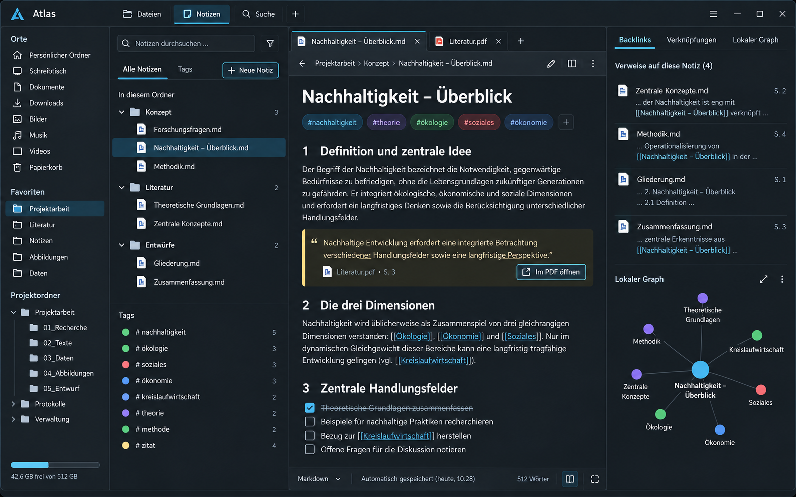
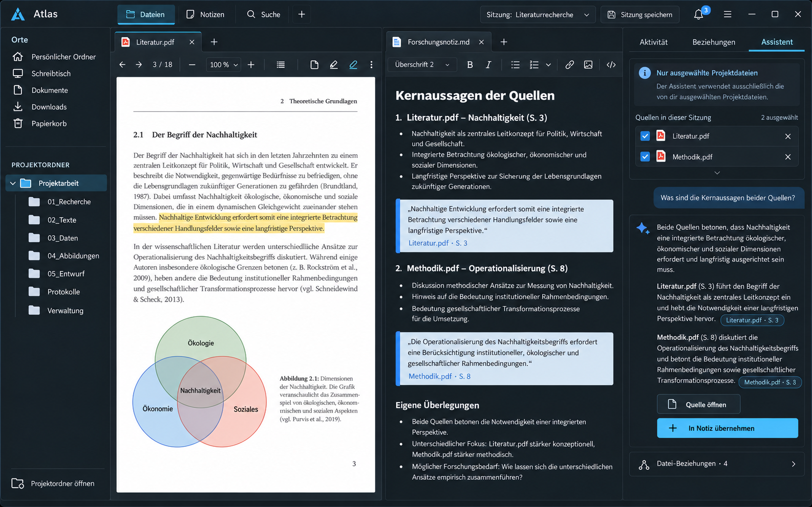
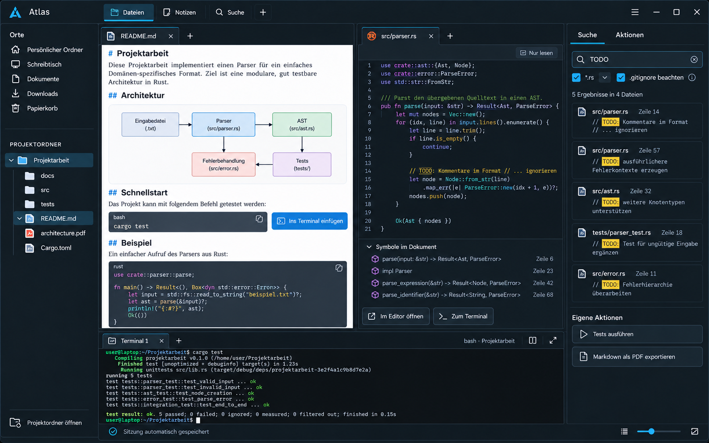
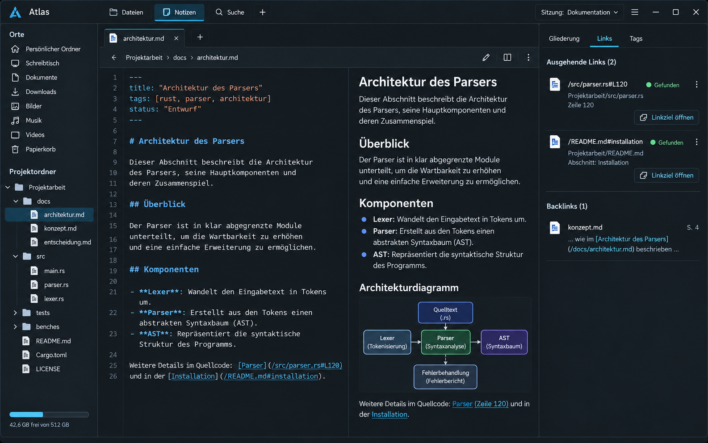
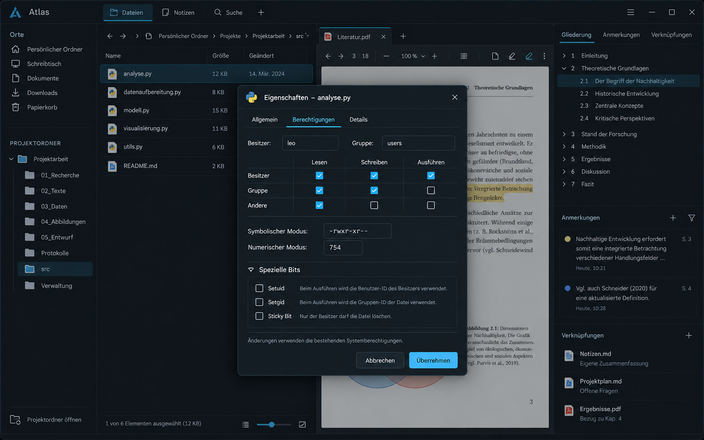
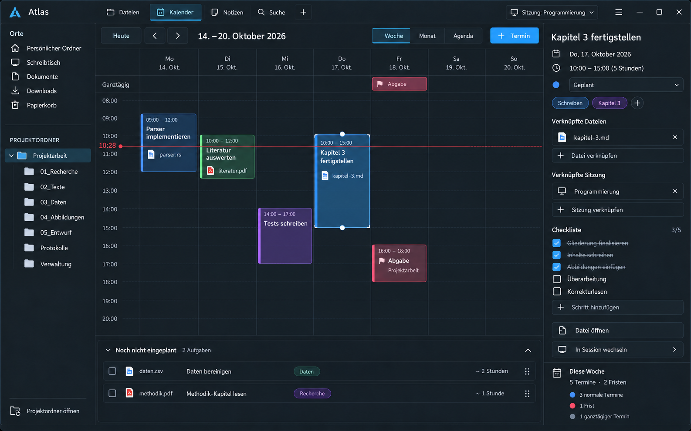

# Atlas Workspace – Konzept und UI-Previews

Das Projekt untersucht einen dateizentrierten Produktivitäts-Workspace, der Dateiverwaltung, PDF-Arbeit und optionale Markdown-Notizen in einer Desktop-Anwendung verbindet.

Lizenz: GPL-3.0-or-later (siehe [LICENSE](LICENSE)) · Copyright © 2026 Minux

**Status:** Phase 2 – vertiefte Arbeitsabläufe (PDF-Annotationen, Notizverknüpfungen, eigene Aktionen, Erweiterungen, Projektkalender mit Nextcloud). Interne Entwickler-Builds, keine Stabilitätszusage.
Ergebnisse und Entscheidungen: [Phase 0](docs/phase0.md) · [Phase 1](docs/phase1.md) · [Phase 2](docs/phase2.md) · [Dateiformate](docs/data-format.md) · [Tastenkürzel](docs/shortcuts.md).

## Entwicklung

Voraussetzung: Nix mit Flakes. Alle Werkzeuge (Rust, Qt 6, Poppler, ripgrep) kommen aus der Flake.

```sh
nix develop                         # Entwicklungsumgebung
cargo run -p atlas-app -- ~/Projekt # Atlas mit einem Projektordner starten
cargo test -p atlas-core            # Kern-Tests (ohne Display)

nix build                           # reproduzierbarer Build → ./result/bin/atlas
nix run . -- ~/Projekt
```

Nützliches:

- `cargo run -p atlas-core --example fixture -- /tmp/atlas-fixture` erzeugt ein Testprojekt (> 10.000 Einträge, PDF, Markdown).
- `atlas --help` zeigt die Kommandozeilenoptionen (u. a. `--open`, `--search`, `--screenshot`).
- Projektdaten (Sitzung, Metadaten, Index) liegen im versteckten Ordner `.atlas/` des Projekts; gerätebezogene Daten unter `~/.local/state/atlas` (`ATLAS_STATE_DIR` überschreibt den Ort). `--no-session` öffnet ein Projekt ohne `.atlas/` anzulegen. `ATLAS_SHELL` wählt die Terminal-Shell.

Tastenkürzel im Prototyp: `Strg+O` Projekt öffnen · `Strg+Umschalt+F` Suche · `Strg+\` Editor teilen · `Strg+W` Pane schließen · `Strg+`` Terminal · `Strg+Umschalt+`` neues Terminal · im Terminal `Strg+Umschalt+C/V` kopieren/einfügen · `Strg+Klick` im Explorer öffnet in neuem Split.

Aufbau: `crates/atlas-core` (Rust, ohne Qt: Dateibaum, Watcher, Suche, PDF, Terminal, Zustand) und `crates/atlas-app` (Qt 6/QML-Oberfläche über cxx-qt).

## Dokumente

- [Produktkonzept](CONCEPT.md)
- [Phasenkonzept](PHASES.md)
- [Konzept der Kalenderansicht](CALENDAR.md)
- [Phase-0-Bericht](docs/phase0.md)
- Im Produktkonzept: detaillierte Skizze der universellen Arbeitsleiste sowie ein Entscheidungsprotokoll aller diskutierten Erweiterungen
- Aktuelle Plattformausrichtung: Linux-first, natives Wayland und Hyprland; zuerst NixOS, Arch Linux gegen Ende der Stabilisierung
- Der Funktionsumfang ist in Phase 1, Phase 2 und Zukunfts-Backlog gegliedert

## Preview-Designs

### 1. Hauptarbeitsbereich – Dark


Die breiteste Produktansicht: klassische Ordnernavigation, Dateiliste, geöffneter PDF-Tab und kontextuelle Seitenleiste. Diese Richtung eignet sich als primäre Desktop-Oberfläche.

### 2. PDF-Vergleich – Light


Ein fokussierter Recherchemodus mit zwei PDF-Dokumenten und einer verknüpften Markdown-Arbeitsnotiz. Er visualisiert die stärkste Abgrenzung zu einem gewöhnlichen Dateimanager.

### 3. Schnellansicht – Dark


Eine temporäre, per Leertaste geöffnete Vorschau über der Dateiliste. Sie unterstützt den häufigsten Ablauf: Dateien schnell prüfen, ohne Tabs oder zusätzliche Fenster zu erzeugen.

### 4. Notizen, Backlinks und lokaler Graph – Dark



Der Notizmodus übernimmt die visuelle Sprache des Hauptarbeitsbereichs. Markdown-Dateien bleiben Teil des normalen Projektordners; Wiki-Links, Tags, Backlinks und ein lokaler Graph ergänzen sie. Zitate aus PDFs enthalten einen direkten Seitenlink zurück zum Quelldokument.

### 5. Hauptarbeitsbereich mit Projektordner – Dark


Die überarbeitete Navigation entfernt Favoriten vollständig. Unter den festen Systemorten befindet sich genau ein geöffneter Projektordner mit seinem aufklappbaren Verzeichnisbaum – ähnlich dem Explorer-Prinzip von VS Code. Dieser Entwurf ersetzt Preview 1 als aktuelle Basis.

### 6. Core-Arbeitsfluss – Dark


Der Core-Entwurf zeigt ausschließlich bestätigte Funktionen: Projektordner, PDF und Markdown im temporären Split, verlinktes PDF-Zitat, universelle Arbeitsleiste, Arbeitskorb und automatische Sitzungsspeicherung. KI, Aktivitätschronik und mehrere benannte Sitzungen sind bewusst nicht enthalten.

### 7. Erweiterte Zukunftsversion – Dark



Diese Variante ergänzt die zurückgestellten Ideen als optionale Zukunftsebene: mehrere benannte Sitzungen, Aktivitätsansicht, Beziehungen zwischen Dateien und einen strikt an ausgewählte Projektdateien gebundenen Assistenten mit anklickbaren Quellenangaben.

### 8. Informatik- und Terminal-Arbeitsbereich – Dark



Der technische Arbeitsbereich verbindet Projektbaum, gerendertes Markdown, Codevorschau, integriertes Terminal, `.gitignore`-bewusste Projektsuche und benutzerdefinierte Aktionen. Befehle aus Dokumenten werden sicher ins Terminal eingefügt, aber nicht automatisch ausgeführt. Komplexe Codebearbeitung wird an den bevorzugten externen Editor übergeben.

### 9. Session-Dropdown – Dark


Das dauerhaft erreichbare Dropdown zeigt die aktive Session, weitere benannte Sessions und deren Umfang. Neue Sessions und Duplikate sind direkt erreichbar; Umbenennen, manuelles Speichern und Löschen bleiben in einem unauffälligen Überlaufmenü verborgen. Ein permanenter Speicherknopf entfällt.

### 10. Markdown, Tags und Projektlinks – Dark



Der Editor zeigt Quelltext und Live-Vorschau nebeneinander. Tags stehen im YAML-Frontmatter, während Links mit führendem `/` vom Projektwurzelordner aufgelöst werden. Die Kontextleiste zeigt ausgehende Links, Backlinks und den Auflösungsstatus.

### 11. Linux-Dateiberechtigungen – Dark



Der Eigenschaftendialog macht Besitzer, Gruppe und Unix-Berechtigungen sowohl als Matrix als auch symbolisch und numerisch bearbeitbar. Spezielle Bits bleiben in einem erweiterten Bereich, damit der normale Dialog übersichtlich bleibt.

### 12. Projektkalender – Dark



Die Wochenansicht verbindet Termine, Fristen, Dateien, Checklisten und benannte Sessions. Nicht eingeplante Aufgaben lassen sich per Drag-and-drop in einen Arbeitsblock verwandeln. Der Kalender bleibt lokal und projektbezogen statt einen allgemeinen Cloud-Kalender nachzubauen.

## Empfohlene Richtung

Der fünfte Entwurf bildet das strukturelle Grundgerüst; der sechste zeigt den derzeit empfohlenen Funktionsumfang im tatsächlichen Arbeitsfluss. Die Schnellansicht ergänzt ihn als alltäglicher Geschwindigkeitsvorteil. Der vierte Entwurf zeigt den optionalen Wissensmodus innerhalb derselben Dateistruktur. PDF-Zitate verbinden beide Bereiche. Preview 7 ist ausdrücklich eine Zukunftsvision und kein Ziel für den ersten Entwicklungsabschnitt.

