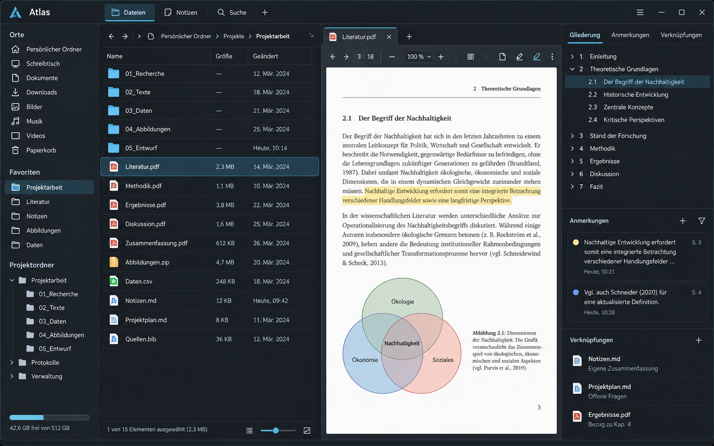
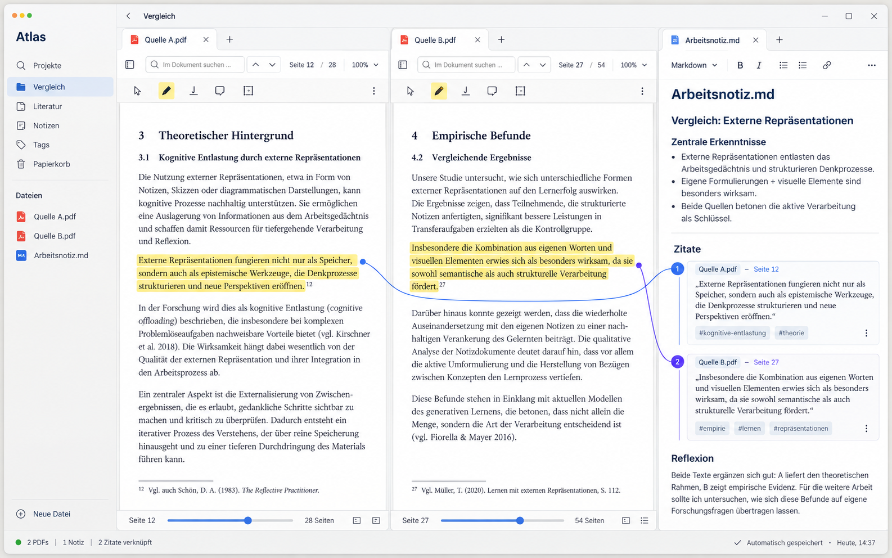
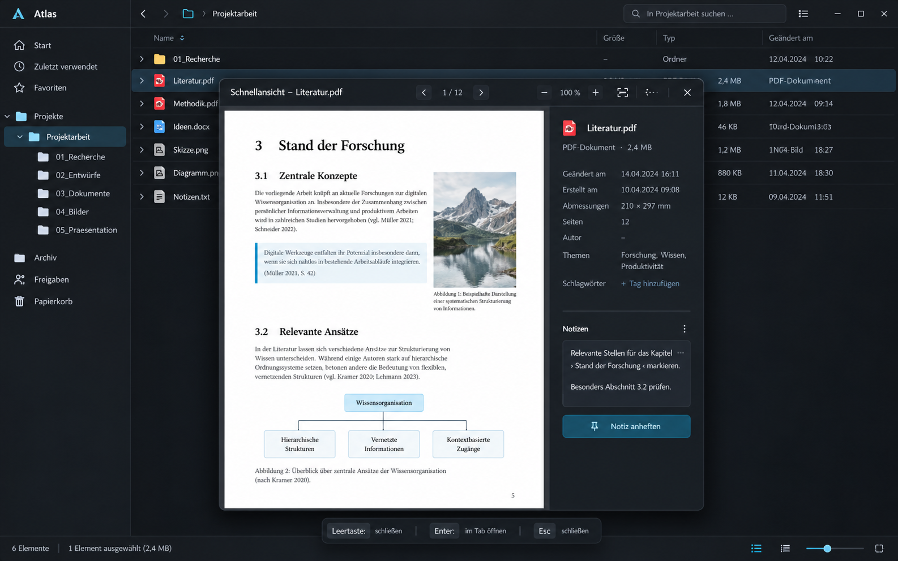
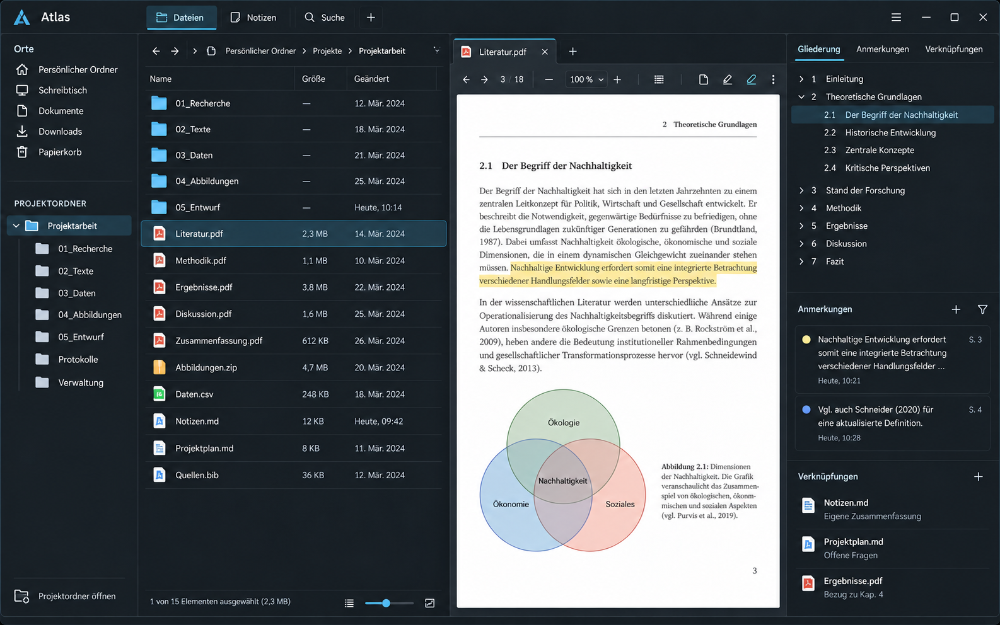
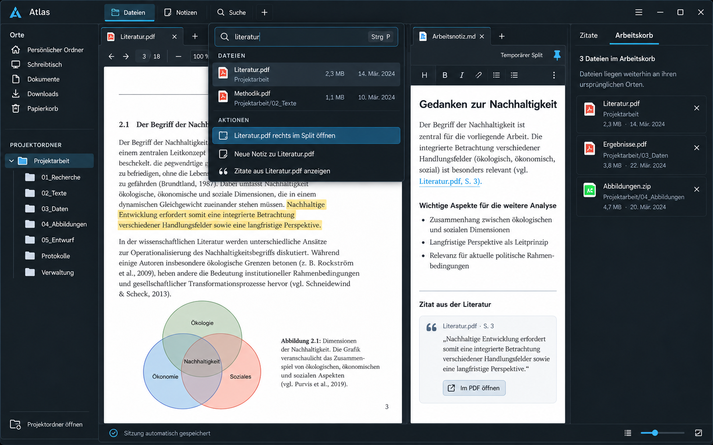
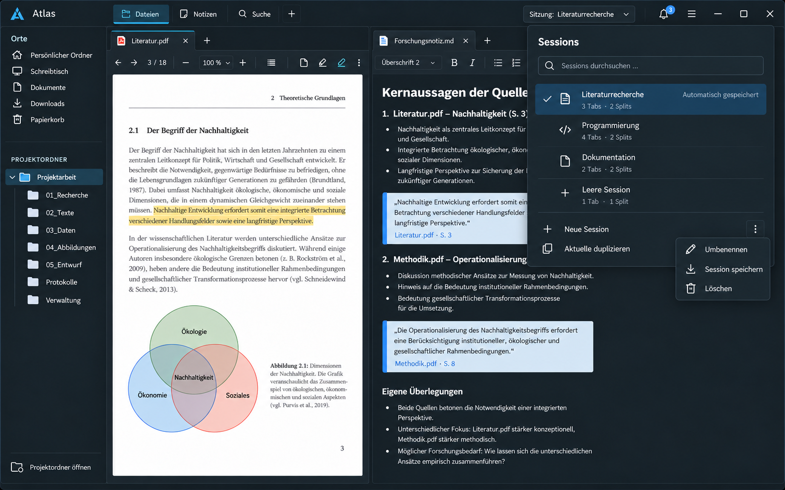

<!--
SPDX-FileCopyrightText: 2026 Minux
SPDX-License-Identifier: GPL-3.0-or-later
-->

# Design-Entwürfe

Die Mockups aus der Konzeptphase. Sie zeigen die Richtung, nicht in jedem
Detail die fertige App; aktuelle Screenshots stehen in der
[README](../../README.md).

## 1. Hauptarbeitsbereich – Dark

Die breiteste Produktansicht: klassische Ordnernavigation, Dateiliste, geöffneter PDF-Tab und kontextuelle Seitenleiste. Diese Richtung eignet sich als primäre Desktop-Oberfläche.

## 2. PDF-Vergleich – Light

Ein fokussierter Recherchemodus mit zwei PDF-Dokumenten und einer verknüpften Markdown-Arbeitsnotiz. Er visualisiert die stärkste Abgrenzung zu einem gewöhnlichen Dateimanager.

## 3. Schnellansicht – Dark

Eine temporäre, per Leertaste geöffnete Vorschau über der Dateiliste. Sie unterstützt den häufigsten Ablauf: Dateien schnell prüfen, ohne Tabs oder zusätzliche Fenster zu erzeugen.

## 4. Notizen, Backlinks und lokaler Graph – Dark

Der Notizmodus übernimmt die visuelle Sprache des Hauptarbeitsbereichs. Markdown-Dateien bleiben Teil des normalen Projektordners; Wiki-Links, Tags, Backlinks und ein lokaler Graph ergänzen sie. Zitate aus PDFs enthalten einen direkten Seitenlink zurück zum Quelldokument.

## 5. Hauptarbeitsbereich mit Projektordner – Dark

Die überarbeitete Navigation entfernt Favoriten vollständig. Unter den festen Systemorten befindet sich genau ein geöffneter Projektordner mit seinem aufklappbaren Verzeichnisbaum – ähnlich dem Explorer-Prinzip von VS Code. Dieser Entwurf ersetzt Preview 1 als aktuelle Basis.

## 6. Core-Arbeitsfluss – Dark

Der Core-Entwurf zeigt ausschließlich bestätigte Funktionen: Projektordner, PDF und Markdown im temporären Split, verlinktes PDF-Zitat, universelle Arbeitsleiste, Arbeitskorb und automatische Sitzungsspeicherung. KI, Aktivitätschronik und mehrere benannte Sitzungen sind bewusst nicht enthalten.

## 7. Erweiterte Zukunftsversion – Dark

Diese Variante ergänzt die zurückgestellten Ideen als optionale Zukunftsebene: mehrere benannte Sitzungen, Aktivitätsansicht, Beziehungen zwischen Dateien und einen strikt an ausgewählte Projektdateien gebundenen Assistenten mit anklickbaren Quellenangaben.

## 8. Informatik- und Terminal-Arbeitsbereich – Dark

Der technische Arbeitsbereich verbindet Projektbaum, gerendertes Markdown, Codevorschau, integriertes Terminal, `.gitignore`-bewusste Projektsuche und benutzerdefinierte Aktionen. Befehle aus Dokumenten werden sicher ins Terminal eingefügt, aber nicht automatisch ausgeführt. Komplexe Codebearbeitung wird an den bevorzugten externen Editor übergeben.

## 9. Session-Dropdown – Dark

Das dauerhaft erreichbare Dropdown zeigt die aktive Session, weitere benannte Sessions und deren Umfang. Neue Sessions und Duplikate sind direkt erreichbar; Umbenennen, manuelles Speichern und Löschen bleiben in einem unauffälligen Überlaufmenü verborgen. Ein permanenter Speicherknopf entfällt.

## 10. Markdown, Tags und Projektlinks – Dark

Der Editor zeigt Quelltext und Live-Vorschau nebeneinander. Tags stehen im YAML-Frontmatter, während Links mit führendem `/` vom Projektwurzelordner aufgelöst werden. Die Kontextleiste zeigt ausgehende Links, Backlinks und den Auflösungsstatus.

## 11. Linux-Dateiberechtigungen – Dark

Der Eigenschaftendialog macht Besitzer, Gruppe und Unix-Berechtigungen sowohl als Matrix als auch symbolisch und numerisch bearbeitbar. Spezielle Bits bleiben in einem erweiterten Bereich, damit der normale Dialog übersichtlich bleibt.

## 12. Projektkalender – Dark

Die Wochenansicht verbindet Termine, Fristen, Dateien, Checklisten und benannte Sessions. Nicht eingeplante Aufgaben lassen sich per Drag-and-drop in einen Arbeitsblock verwandeln. Der Kalender bleibt lokal und projektbezogen statt einen allgemeinen Cloud-Kalender nachzubauen.

## Empfohlene Richtung

Der fünfte Entwurf bildet das strukturelle Grundgerüst; der sechste zeigt den derzeit empfohlenen Funktionsumfang im tatsächlichen Arbeitsfluss. Die Schnellansicht ergänzt ihn als alltäglicher Geschwindigkeitsvorteil. Der vierte Entwurf zeigt den optionalen Wissensmodus innerhalb derselben Dateistruktur. PDF-Zitate verbinden beide Bereiche. Preview 7 ist ausdrücklich eine Zukunftsvision und kein Ziel für den ersten Entwicklungsabschnitt.

