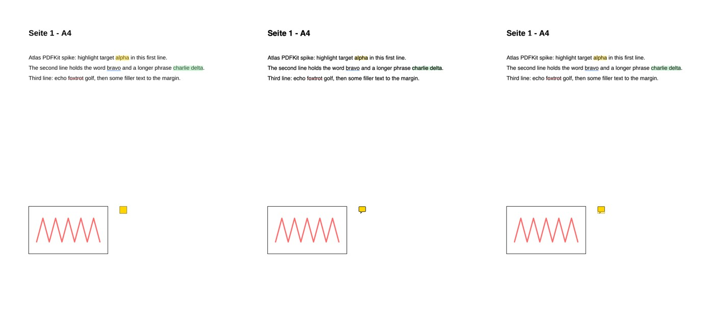
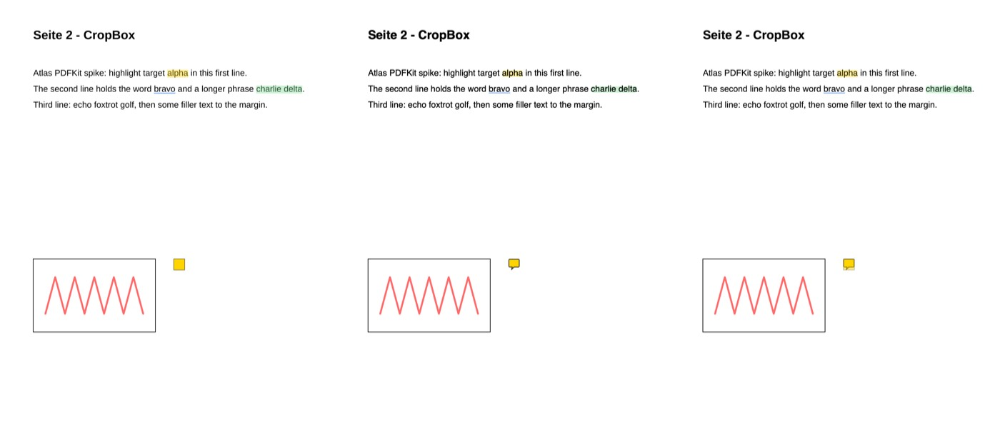
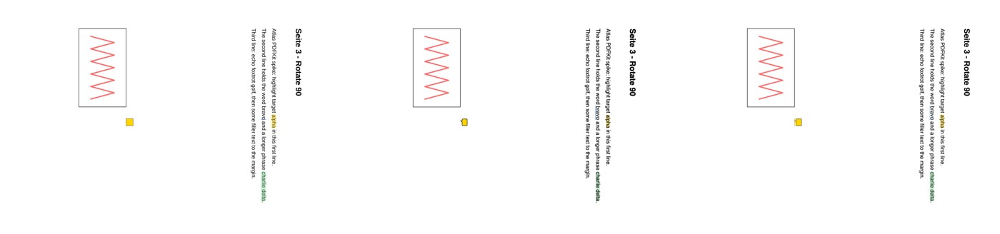
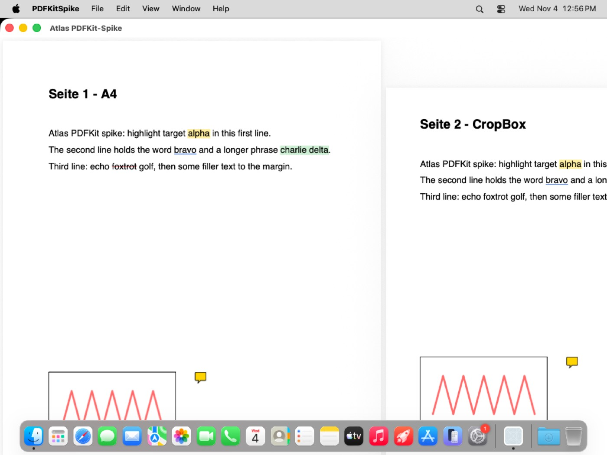

<!--
SPDX-FileCopyrightText: 2026 Minux
SPDX-License-Identifier: GPL-3.0-or-later
-->

# Spike PDFKit (P0.4) – Bericht

Stand 04.11.2026 · Aufgabe #16 · Code in `spikes/pdfkit/`, CI `.github/workflows/mac-P0.4.yml`
(macOS 26, Xcode 26, GitHub-Runner arm64)

## Ergebnis

**PDFKit taugt für die PDF-Anzeige der Mac-Version. Atlas-Anmerkungen lassen sich
verlustfrei hin- und herrechnen.**

- Gespeicherte Atlas-Anmerkungen (Linux, poppler) erscheinen in PDFKit an derselben Stelle
  – entlang der Zeile auf ±0,5 pt, PDFKit rückt Highlights nur quer etwas ein (siehe [Gezeichnete Markierungen](#gezeichnete-markierungen-macos-gegen-linux)).
  Das gilt auch für die beiden Fälle, die schiefgehen können: eine CropBox, die nicht bei
  (0, 0) beginnt, und `/Rotate 90`.
- Eine Textauswahl in PDFKit ergibt dieselben Atlas-Rechtecke, die poppler unter Linux
  speichert. Anfang und Länge der Auswahl stimmen auf 0,00 pt überein. Quer zur Zeile ist
  PDFKit 1,05 pt dicker, weil PDFKit andere Glyphenboxen verwendet; die Mitte weicht um
  0,2 pt ab.
- Die Umrechnung ist eine reine Funktion (`PageGeometry`, `spikes/pdfkit/Sources/Coordinates.swift`)
  und wird in P3.2 zu `Features/PDF/Coordinates.swift`.

## Aufbau

| Teil | Datei |
|---|---|
| Test-PDF: S. 1 A4, S. 2 Letter mit CropBox (36, 48)–(576, 744), S. 3 A4 mit `/Rotate 90` | `fixtures/make_pdf.py` → `fixtures/spike.pdf` |
| Linux-Referenz: Anmerkungen (Markieren, Unterstreichen, Durchstreichen, Freihand, Notiz) im Atlas-Format mit den Rechtecken von poppler; Seitenbilder von poppler/cairo mit dem Overlay wie `PdfViewer.qml` | `fixtures/linux_reference.py` → `fixtures/spike.atlas.json`, `fixtures/ref-page-*.png` |
| Atlas-Datei lesen | `Sources/AtlasAnnotationFile.swift` |
| Umrechnung Atlas ↔ PDFKit-Seitenraum | `Sources/Coordinates.swift` |
| Atlas → `PDFAnnotation` (Highlight/Underline/StrikeOut mit Quadpoints, Text-Notiz, Ink), Auswahl → Atlas-Rechtecke | `Sources/PDFKitBridge.swift` |
| Seite mit Anmerkungen rendern, Vergleichsbild, Messung | `Sources/PageRenderer.swift` |
| SwiftUI-App mit `PDFView`; zeigt eine Auswahl als Atlas-Rechtecke an | `Sources/PDFKitSpikeApp.swift` |
| Tests | `Tests/CoordinatesTests.swift`, `Tests/ParityTests.swift` |

Die Referenz neu erzeugen (Linux, Ubuntu): `apt install gir1.2-poppler-0.18 python3-gi-cairo`,
dann `python3 fixtures/make_pdf.py` (reportlab, pypdf) und
`/usr/bin/python3 fixtures/linux_reference.py` (das System-Python, zu dem die GI-Pakete gehören).
Auf dem Mac: `spikes/pdfkit/run.sh` (nach `apps/macos/scripts/bootstrap.sh`).

## Koordinaten

**Atlas** (so liefert poppler sie, so speichert die Linux-App sie): PDF-Punkte, Ursprung oben
links in der **CropBox**, Achsen der Seite **wie angezeigt**, also nach `/Rotate`.

**PDFKit-Seitenraum:** ungedreht, Ursprung unten links in der MediaBox, y nach oben;
`PDFPage.bounds(for: .cropBox)` liegt in diesem Raum.

Mit CropBox `C` (Breite `W`, Höhe `H`) und `(u, v)` = ungedreht, oben links in `C`, y nach unten:

| `/Rotate` | Atlas `(x, y)` aus `(u, v)` | Seitenraum aus Atlas |
|---|---|---|
| 0 | `(u, v)` | `(C.minX + x, C.maxY − y)` |
| 90 | `(H − v, u)` | `u = y`, `v = H − x` |
| 180 | `(W − u, H − v)` | `u = W − x`, `v = H − y` |
| 270 | `(v, W − u)` | `u = W − y`, `v = x` |

und Seitenraum `= (C.minX + u, C.maxY − v)`. Rechtecke werden über zwei Ecken umgerechnet
und normalisiert. Ohne Drehung und ohne CropBox-Versatz bleibt es bei `y' = Seitenhöhe − y`
wie im Plan.

## Messwerte

### Auswahl in PDFKit → Atlas-Rechtecke

`PDFDocument.findString` → `selectionsByLine()` → `bounds(for:)` → `PageGeometry.toAtlas`,
verglichen mit dem Rechteck, das poppler für denselben Text liefert. Werte in Punkten; „entlang“
ist auf S. 3 die y-Achse.

| S. | Text | poppler (Linux) | PDFKit | Δ Anfang | Δ Mitte quer | Δ Länge | Δ Dicke |
|---|---|---|---|---|---|---|---|
| 1 | alpha | 291.42, 139.95, 34.24, 12.95 | 291.42, 139.22, 34.24, 14.00 | +0.00 | −0.20 | +0.00 | +1.05 |
| 1 | bravo | 269.65, 165.95, 35.01, 12.95 | 269.65, 165.22, 35.01, 14.00 | +0.00 | −0.20 | +0.00 | +1.05 |
| 1 | charlie delta | 436.97, 165.95, 75.47, 12.95 | 436.97, 165.22, 75.47, 14.00 | +0.00 | −0.20 | +0.00 | +1.05 |
| 1 | foxtrot | 171.60, 191.95, 38.91, 12.95 | 171.60, 191.22, 38.91, 14.00 | +0.00 | −0.20 | +0.00 | +1.05 |
| 2 | alpha | 273.42, 113.95, 34.24, 12.95 | 273.42, 113.22, 34.24, 14.00 | +0.00 | −0.20 | +0.00 | +1.05 |
| 2 | bravo | 251.65, 139.95, 35.01, 12.95 | 251.65, 139.22, 35.01, 14.00 | +0.00 | −0.20 | +0.00 | +1.05 |
| 2 | charlie delta | 418.97, 139.95, 75.47, 12.95 | 418.97, 139.22, 75.47, 14.00 | +0.00 | −0.20 | +0.00 | +1.05 |
| 3 | alpha | 688.99, 291.42, 12.95, 34.24 | 688.67, 291.42, 14.00, 34.24 | +0.00 | +0.20 | +0.00 | +1.05 |
| 3 | bravo | 662.99, 269.65, 12.95, 35.01 | 662.67, 269.65, 14.00, 35.01 | +0.00 | +0.20 | +0.00 | +1.05 |
| 3 | charlie delta | 662.99, 436.97, 12.95, 75.47 | 662.67, 436.97, 14.00, 75.47 | +0.00 | +0.20 | +0.00 | +1.05 |

### Gezeichnete Markierungen: macOS gegen Linux

Ausdehnung der Markierungsfarbe in den gerenderten Seiten (2 px je Punkt), auf beiden Bildern
mit demselben Verfahren gemessen (`MeasuredExtent`), in Punkten. Linux: poppler/cairo mit dem
Overlay wie `PdfViewer.qml`; macOS: `PDFPage.draw(with:to:)` mit den umgerechneten
`PDFAnnotation`s. Grenze im Test: 1,5 pt je Kante.

| S. | Text | gespeichert (Atlas) | Linux gemessen | macOS gemessen | max. Abweichung |
|---|---|---|---|---|---|
| 1 | alpha | 291.42, 139.95, 34.24, 12.95 | 291.0, 140.0, 35.0 × 13.0 | 291.5, 141.0, 34.5 × 11.0 | 1,0 pt |
| 1 | charlie delta | 436.97, 165.95, 75.47, 12.95 | 437.0, 166.0, 75.5 × 13.0 | 437.0, 167.5, 75.5 × 10.5 | 1,5 pt |
| 2 | alpha | 273.42, 113.95, 34.24, 12.95 | 273.0, 114.0, 35.0 × 13.0 | 273.5, 115.0, 34.5 × 11.0 | 1,0 pt |
| 2 | charlie delta | 418.97, 139.95, 75.47, 12.95 | 419.0, 140.0, 75.5 × 13.0 | 419.0, 141.0, 75.5 × 10.5 | 1,5 pt |
| 3 | alpha | 688.99, 291.42, 12.95, 34.24 | 689.0, 291.0, 13.0 × 35.0 | 690.0, 291.5, 11.0 × 34.5 | 1,0 pt |
| 3 | charlie delta | 662.99, 436.97, 12.95, 75.47 | 663.0, 437.0, 13.0 × 75.5 | 664.0, 437.0, 10.5 × 75.5 | 1,5 pt |

Entlang der Zeile liegen beide Bilder auf ±0,5 pt (eine Pixelreihe) übereinander. Quer dazu
zeichnet PDFKit Highlights rund 1 pt oben und unten **eingerückt** (Höhe 10,5–11 statt 13 pt):
Das ist PDFKits eigene Highlight-Darstellung, nicht die Lage – die Mitte ist identisch. Die
1,5 pt liegen genau an der Testgrenze; stören wird das niemanden, aber wer in P3.2 die
Linux-Optik exakt will, zeichnet Highlights selbst (`PDFAnnotation`-Unterklasse mit
`draw(with:in:)`) statt PDFKits Standardaussehen zu nehmen.

Unterstreichen, Durchstreichen, Freihand und Notizen liegen in den Vergleichsbildern
sichtbar deckungsgleich (nicht gemessen; Notizen zeichnet PDFKit als Sprechblase statt als
Quadrat).

Vergleichsbilder (Linux | macOS | Überlagerung, macOS mit Linux zu 50 % darüber):

Die App auf dem CI-Runner (`PDFView`, Seiten nebeneinander):

## Befunde für andere Aufgaben

1. **`docs/data-format.md` ist ungenau** (Integrator): Dort steht „Ursprung oben links auf
   der unrotierten Seite“. poppler-glib und damit jede gespeicherte Datei verwenden die
   **gedrehte, angezeigte** Seite, relativ zur **CropBox** (S. 3 der Test-PDF: poppler meldet
   841,89 × 595,28 pt und vertikale Wortrechtecke). Vorschlag für den Satz: „Koordinaten sind
   PDF-Punkte, Ursprung oben links auf der Seite, wie sie angezeigt wird (CropBox, nach
   `/Rotate`).“ Der Mac rechnet nach dem tatsächlichen Verhalten um; am Format ändert sich nichts.
2. **Fehler unter Linux:** Unterstreichen und Durchstreichen auf Seiten mit `/Rotate 90/270`
   zeichnet `PdfViewer.qml` als waagerechte Linie am unteren Rand des (senkrechten) Rechtecks
   statt entlang des Textes (`fixtures/ref-page-3.png`, „bravo“). PDFKit zeichnet sie richtig.
   Auch der Export (`export_annotated`) sollte auf gedrehten Seiten geprüft werden. Eigener
   Fehlerbericht, nicht Teil des Ports.
3. **PDFKit-Glyphenboxen** sind 1,05 pt höher als die von poppler (bei 14 pt Helvetica). Eine
   auf dem Mac angelegte Markierung ist unter Linux also minimal dicker und umgekehrt; das ist
   unsichtbar und braucht keine Angleichung.
4. **Rendern einer Seite:** `PDFPage.draw(with:to:)` wendet CropBox und `/Rotate` selbst an.
   Wer zusätzlich `transform(for:)` anwendet, verschiebt bzw. dreht doppelt (erster CI-Lauf).
   Wichtig für P3.2 (Bereich als Bild, Export, Miniaturen).
5. **CI-Artefakte:** Der Upload der Artefakte lief einmal in einen Timeout (`CreateArtifact`),
   obwohl die Tests grün waren; der Job ist dann rot. Bilder stehen zusätzlich im Log
   (`ci-screenshots.sh`), die wichtigen liegen hier im Repo.
6. **Farben:** PDFKit zeichnet Highlights mit eigener Mischung; mit Farbe × 0,38 wie unter Linux
   wirkt Gelb auf dem Mac etwas kräftiger, Grün blasser. Feinabstimmung in P3.2/P4.5.

## Für P3.2 übernehmen

- `PageGeometry` unverändert (inkl. Tests) nach `Features/PDF/Coordinates.swift`.
- Anmerkungen als echte `PDFAnnotation`s nur zur Anzeige; Quelle bleibt die Atlas-Datei
  (über `atlas-api`, P2.6). Zuordnung über `userName` = Atlas-ID (im Spike so gesetzt).
- Auswahl → Atlas: `selectionsByLine()` je Seite; über mehrere Seiten je Seite ein Eintrag mit
  gemeinsamer `group` (wie Linux).
- Offen für P3.2: Werkzeuge (Stift, Radierer) als Eingabe in `PDFView`, Hit-Testing für
  Notizen, Präsentationsmodus, Dunkelmodus der Seiten; Seiten mit `/Rotate 180/270` und
  gedrehtem Text innerhalb der Seite in die Tests aufnehmen.
