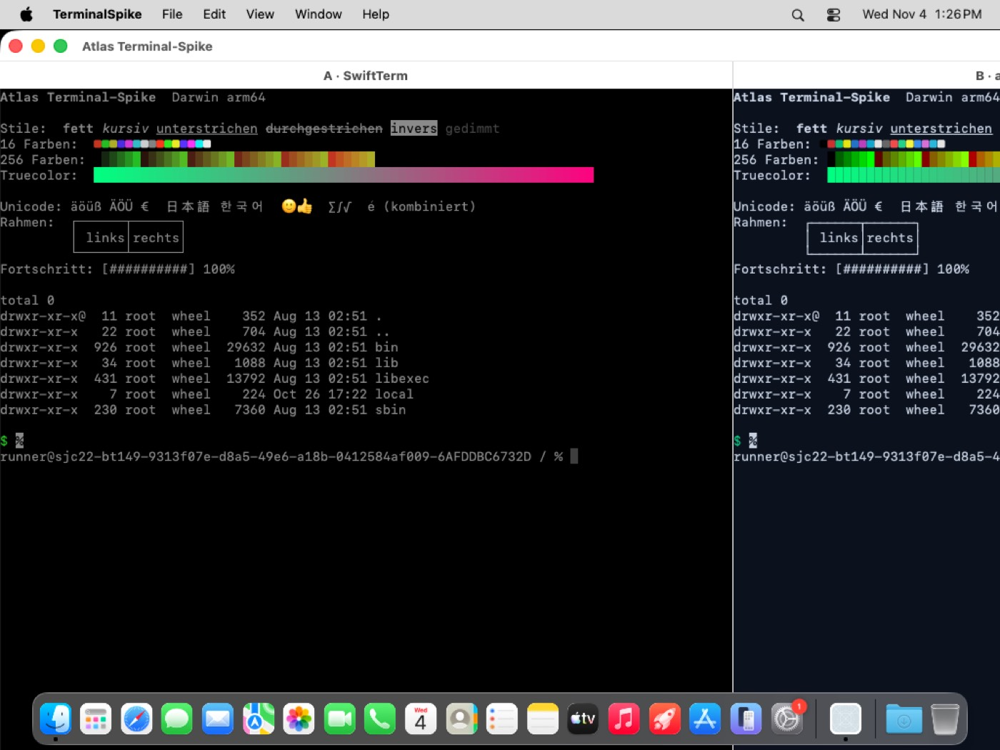
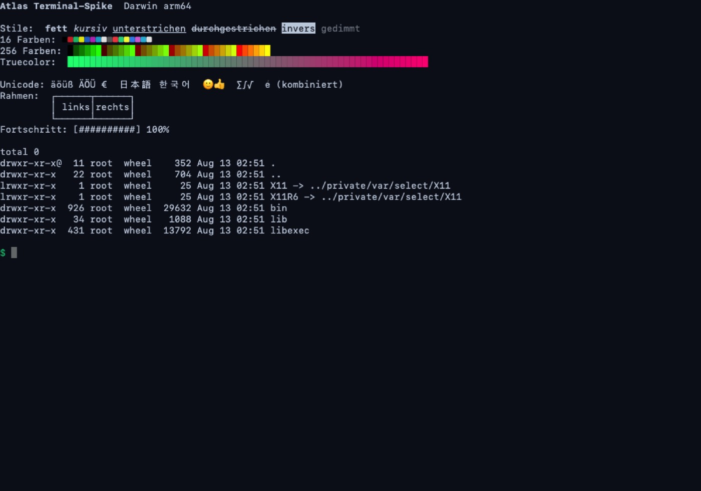

<!--
SPDX-FileCopyrightText: 2026 Minux
SPDX-License-Identifier: GPL-3.0-or-later
-->

# Spike Terminal (P0.5) – Bericht

Stand 04.11.2026 · Aufgabe #17 · Code in `spikes/terminal/`, CI `.github/workflows/mac-P0.5.yml`
(macOS 26.6, Xcode 26.6, Swift 6.3, GitHub-Runner arm64)

## Entscheidung: **SwiftTerm** (Variante A)

Beide Varianten laufen, stellen dasselbe richtig dar und sind gleich schnell. Den Ausschlag
gibt der Aufwand: SwiftTerm bringt alles mit, was eine Terminal-*Ansicht* auf dem Mac braucht
(Tastatur inkl. Eingabemethoden, Auswahl, Kopieren/Einfügen, Maus-Weitergabe, Scrollen,
Verlauf, Bedienungshilfen). Für Variante B müsste das alles in Swift neu geschrieben werden;
der Kern liefert nur das Raster. Nach E16 (bei Gleichstand die schneller fertige Variante)
also SwiftTerm.

Folgen:

- **P2.9 entfällt** (kein `atlas-api`-Terminaldienst) – Issue #32 als „nicht geplant“ schließen.
- **P3.5** baut auf `LocalProcessTerminalView` (SwiftTerm, Swift-Paket, MIT-Lizenz) auf.
- `atlas-terminal` bleibt für Linux unverändert.

## Was verglichen wurde

| | A: SwiftTerm | B: `atlas-terminal` + Swift-Renderer |
|---|---|---|
| Aufbau | Swift-Paket `SwiftTerm` 1.99.2, `LocalProcessTerminalView` (eigene PTY, eigener Emulator) | `atlas-terminal` (alacritty_terminal 0.26) als Rust-Staticlib mit C-Schnittstelle (`spikes/terminal/core/`), Frames als JSON, Zeichnen mit CoreText (`CoreTerminalView.swift`) |
| Code im Spike | ~15 Zeilen (`SwiftTermPane`) | ~200 Zeilen Rust + ~280 Zeilen Swift, und noch unvollständig (s. u.) |
| Darstellung (Demo-Skript) | vollständig | vollständig |
| Eingabe | Tastatur, Eingabemethoden (IME), Tastenkürzel, Maus, Auswahl, Kopieren/Einfügen | im Spike nur Text, Enter, Rücktaste, Tab, Esc, Pfeile; `encode_key` arbeitet mit Qt-Tastencodes und müsste für `NSEvent` portiert werden, IME (`NSTextInputClient`) fehlt ganz |
| Auswahl, Maus, Scrollbalken | vorhanden | Kern kann es (`select_*`, `encode_mouse`), Swift-Seite fehlt |
| Bedienungshilfen (VoiceOver) | vorhanden | fehlt |
| Gleiches Verhalten wie Linux | nein, eigener Emulator (xterm-kompatibel) | ja, derselbe Emulator |
| Bundle-Größe | Swift-Paket, klein | +24 MB Staticlib (fällt im echten Port weg, weil der Kern ohnehin gelinkt wird) |

## Messwerte

Release-Build beider Varianten, gleicher Runner; `spikes/terminal/Tests/TerminalSpikeTests.swift`.

| Variante | Messung | Wert |
|---|---|---|
| A SwiftTerm | `seq 1 200000` über PTY (1,3 MB), bis Prozessende | 519 ms |
| B atlas-terminal | `seq 1 200000` über PTY (1,3 MB), bis Prozessende | 493 ms |
| A SwiftTerm | 1,3 MB direkt in den Parser (ohne PTY) | 43 ms |
| B atlas-terminal | Frame holen (Rust → JSON → Swift), voller Demo-Bildschirm | 3,2 ms |
| B atlas-terminal | Frame zeichnen (CoreText), 1000 × 700 pt | 4,9 ms |

Der Durchsatz ist praktisch gleich (die PTY bestimmt ihn). B käme mit 8 ms pro Bild auf
60 Hz, ohne JSON (UniFFI-Records) und mit Neuzeichnen nur geänderter Zeilen deutlich
darunter. Die Zeichenzeit von SwiftTerm ließ sich offscreen nicht sauber messen (die Ansicht
zeichnet ohne sichtbares Fenster nicht); im App-Fenster läuft sie flüssig.

Im Debug-Build ist SwiftTerm rund 70-mal langsamer (1,3 MB Parser: 3,3 s statt 43 ms) –
die Mac-App muss für Messungen und Auslieferung optimiert gebaut werden (selbstverständlich,
aber beim Ausprobieren in Xcode auffällig).

## Bildschirmfotos

Beide Varianten nebeneinander mit demselben Demo-Skript (`spikes/terminal/demo.sh`: Stile,
16/256/Truecolor-Farben, Umlaute, CJK, Hangul, Emoji, kombinierte Zeichen, Rahmenlinien,
Fortschrittsbalken mit `\r`, `ls -la`), links A, rechts B (abgeschnitten):

Variante B einzeln (Offscreen-Render aus dem Test):

Kleine Unterschiede: B zeichnet Truecolor-Hintergründe mit feinen Fugen zwischen den Zellen
(Zellbreite ist keine ganze Pixelzahl; Rechtecke müssten auf Pixel gerundet werden).

## Was P3.5 mit SwiftTerm noch braucht

- **Atlas-Farben und Schrift:** die Palette aus `crates/atlas-terminal/src/colors.rs`
  (hell/dunkel) per `installColors` setzen; Schrift aus den Einstellungen.
- **Aktuelles Verzeichnis** (für „Datei hier öffnen“, Sitzungen): `current_dir` des Kerns liest
  `/proc` und geht auf dem Mac nicht; P1.2 liefert `proc_pidinfo` in der Plattform-Schicht,
  alternativ OSC 7 aus SwiftTerm (`hostCurrentDirectoryUpdate`).
- **Bildschirmtext** (`screen_text`, z. B. für Aktionen): aus dem SwiftTerm-Puffer
  (`getLine`/`translateToString`). Achtung: hinter breiten Zeichen steht dort eine Füllzelle,
  die nicht U+0020 ist – beim Zusammensetzen herausfiltern (im Test so gemacht).
- **Shell-Auswahl** wie `atlas_terminal::default_shell` (ATLAS_SHELL, Login-Shell, `$SHELL`)
  und Umgebung (`TERM=xterm-256color`, `COLORTERM=truecolor`, `TERM_PROGRAM=atlas`).
- **Build:** SwiftTerm 1.99 bringt das Build-Plugin `SwiftTermBuildInfoPlugin` mit. In Xcode
  einmal freigeben; in der CI `xcodebuild -skipPackagePluginValidation` (so in `run.sh`).
  Version im Xcode-Projekt fest pinnen (P3.0, Integrator).
- Kein App-Sandbox (Terminal startet beliebige Programme) – passt zu E15.

## Befunde

1. `atlas_terminal::TermEvent::Exited` kommt beim Prozessende **zweimal** (alacritty meldet
   `ChildExit` und `Exit`). Unter Linux harmlos; wer darauf genau einmal reagieren muss,
   sollte entprellen. Kleiner Fix im Kern möglich (nicht Teil des Ports).
2. `current_dir` funktioniert auf macOS nicht (`/proc`) – bekannt, P1.2.
